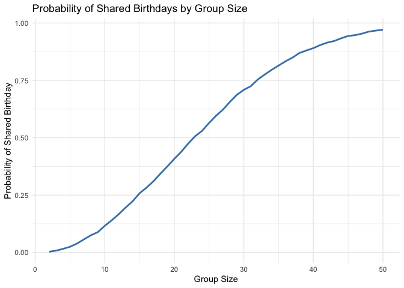

P8105 Homework 5
================
Cecilia Zhao

## Problem 1

``` r
birthday_repeated = function(n_room) {
  birthdays = sample(1:365, size = n_room, replace = TRUE)
  
  repeated_birthdays = length(unique(birthdays)) < n_room
  
  return(repeated_birthdays)
}
```

``` r
set.seed(123)

birthday_results = 
  expand_grid(
    n_room = 2:50,
    sim = 1:10000
  ) |>
  mutate(
    repeated = map_lgl(n_room, birthday_repeated)
  )

birthday_prob = birthday_results |>
  group_by(n_room) |>
  summarize(
    probability = mean(repeated)
  )
```

``` r
birthday_prob |>
  ggplot(aes(x = n_room, y = probability)) +
  geom_line(color = "steelblue", linewidth = 1) +
  labs(
    title = "Probability of Shared Birthdays by Group Size",
    x = "Group Size",
    y = "Probability of Shared Birthday"
  ) +
  theme_minimal()
```

<!-- -->

The probability that at least two people share a birthday increases as
group size increases. When there are approximately 23 people in a room,
the probability exceeds 50%. By the time the group size reaches 50, the
probability is approximately 97%. This result illustrates the birthday
paradox, which shows that shared birthdays are more likely than we might
intuitively expect.
