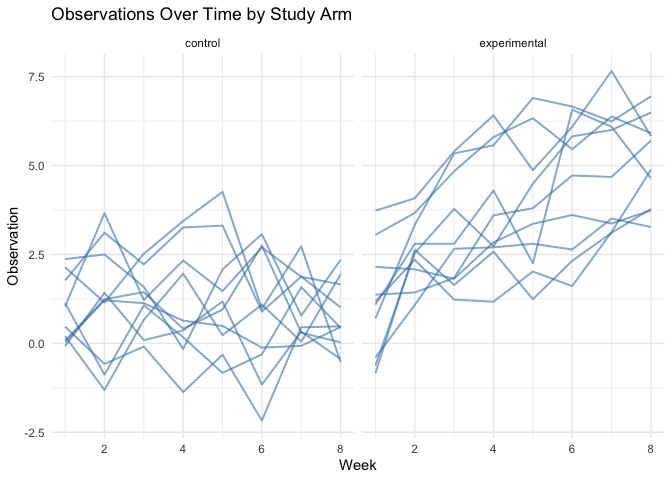
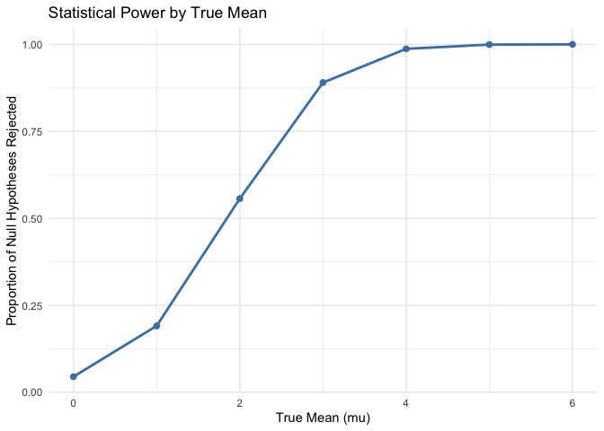
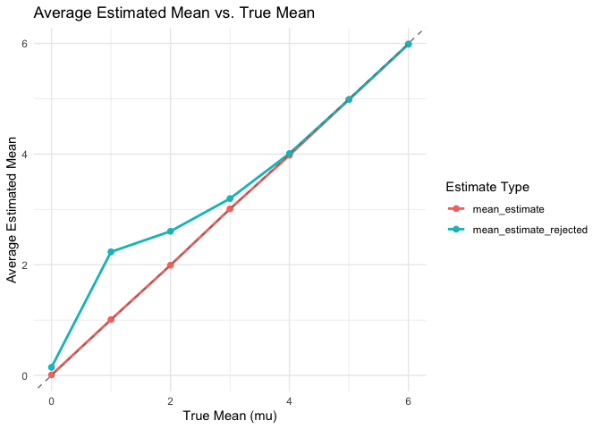

P8105 Homework 5
================
Cecilia Zhao

## Problem 1

``` r
birthday_repeated = function(n_room) {
  birthdays = sample(1:365, size = n_room, replace = TRUE)
  
  repeated_birthdays = length(unique(birthdays)) < n_room
  
  return(repeated_birthdays)
}
```

``` r
set.seed(123)

birthday_results = 
  expand_grid(
    n_room = 2:50,
    sim = 1:10000
  ) |>
  mutate(
    repeated = map_lgl(n_room, birthday_repeated)
  )

birthday_prob = birthday_results |>
  group_by(n_room) |>
  summarize(
    probability = mean(repeated)
  )
```

``` r
birthday_prob |>
  ggplot(aes(x = n_room, y = probability)) +
  geom_line(color = "steelblue", linewidth = 1) +
  labs(
    title = "Probability of Shared Birthdays by Group Size",
    x = "Group Size",
    y = "Probability of Shared Birthday"
  ) +
  theme_minimal()
```

<!-- -->

The probability that at least two people share a birthday increases as
group size increases. For a group of 23 people, the simulated
probability is 0.507. By the time the group size reaches 50, the
probability is approximately 0.971. This result illustrates the birthday
paradox, which shows that shared birthdays are more likely than we might
intuitively expect.

## Problem 2

``` r
file_names = list.files(
  path = "data",
  pattern = "\\.csv$",
  full.names = TRUE
)

file_df = tibble(file_name = file_names)
```

``` r
file_df = file_df |>
  mutate(
    data = map(file_name, read_csv)
  )
```

``` r
longitudinal_df = file_df |>
  unnest(cols = data)
```

``` r
longitudinal_df = longitudinal_df |>
  mutate(
    file_name = basename(file_name),
    file_name = str_remove(file_name, ".csv")
  ) |>
  separate(
    file_name,
    into = c("arm", "subject_id"),
    sep = "_"
  ) |>
  mutate(
    arm = recode(arm,
                 "con" = "control",
                 "exp" = "experimental")
  )
```

``` r
longitudinal_df = longitudinal_df |>
  pivot_longer(
    cols = starts_with("week_"),
    names_to = "week",
    values_to = "observation"
  ) |>
  mutate(
    week = as.numeric(str_remove(week, "week_"))
  )
```

``` r
longitudinal_df |>
  ggplot(
    aes(
      x = week,
      y = observation,
      group = subject_id
    )
  ) +
  geom_line(color = "steelblue", alpha = 0.6, linewidth = 0.7) +
  facet_wrap(~arm) +
  labs(
    title = "Observations Over Time by Study Arm",
    x = "Week",
    y = "Observation"
  ) +
  theme_minimal()
```

<!-- -->

Observations in the control group fluctuate over time without a clear
overall trend. Observations in the experimental group generally increase
over the eight weeks. By the end of the study, the experimental group
tends to have higher observation values than the control group. There is
also some variability among individuals within each group.

## Problem 3

``` r
sim_t_test = function(mu) {
  sim_data = tibble(
    x = rnorm(n = 30, mean = mu, sd = 5)
  )

  t.test(sim_data$x, mu = 0) |>
    broom::tidy() |>
    select(estimate, p.value)
}
```

``` r
set.seed(123)

sim_results = expand_grid(
  mu = 0:6,
  sim = 1:5000
) |>
  mutate(
    results = map(mu, sim_t_test)
  ) |>
  unnest(cols = results)
```

``` r
power_df = sim_results |>
  group_by(mu) |>
  summarize(
    power = mean(p.value < 0.05)
  )

power_df
```

    ## # A tibble: 7 × 2
    ##      mu  power
    ##   <int>  <dbl>
    ## 1     0 0.0446
    ## 2     1 0.191 
    ## 3     2 0.556 
    ## 4     3 0.890 
    ## 5     4 0.987 
    ## 6     5 0.999 
    ## 7     6 1

``` r
power_df |>
  ggplot(aes(x = mu, y = power)) +
  geom_line(color = "steelblue", linewidth = 1) +
  geom_point(color = "steelblue", size = 2) +
  labs(
    title = "Statistical Power by True Mean",
    x = "True Mean (mu)",
    y = "Proportion of Null Hypotheses Rejected"
  ) +
  theme_minimal()
```

<!-- -->

The proportion of rejected null hypotheses increases as the true mean
increases. When the true mean is zero, the rejection rate is
approximately 0.045, which is close to the significance level of 0.05.
As the true mean moves further away from zero, statistical power
increases and eventually approaches 1. This suggests that larger effect
sizes are easier to detect when the sample size and standard deviation
are held constant.

``` r
mean_estimates = sim_results |>
  group_by(mu) |>
  summarize(
    mean_estimate = mean(estimate),
    mean_estimate_rejected = mean(estimate[p.value < 0.05])
  )

mean_estimates
```

    ## # A tibble: 7 × 3
    ##      mu mean_estimate mean_estimate_rejected
    ##   <int>         <dbl>                  <dbl>
    ## 1     0       0.00900                  0.147
    ## 2     1       1.01                     2.23 
    ## 3     2       1.99                     2.60 
    ## 4     3       3.01                     3.20 
    ## 5     4       3.98                     4.01 
    ## 6     5       4.98                     4.99 
    ## 7     6       5.99                     5.99

``` r
mean_estimates |>
  pivot_longer(
    cols = c(mean_estimate, mean_estimate_rejected),
    names_to = "estimate_type",
    values_to = "average_estimate"
  ) |>
  ggplot(aes(
    x = mu,
    y = average_estimate,
    color = estimate_type
  )) +
  geom_line(linewidth = 1) +
  geom_point(size = 2) +
  geom_abline(
    slope = 1,
    intercept = 0,
    linetype = "dashed",
    color = "gray50"
  ) +
  labs(
    title = "Average Estimated Mean vs. True Mean",
    x = "True Mean (mu)",
    y = "Average Estimated Mean",
    color = "Estimate Type"
  ) +
  theme_minimal()
```

<!-- -->

The average estimated mean across all simulations is approximately equal
to the true mean, indicating that the sample mean is an unbiased
estimator.

However, when considering only samples where the null hypothesis was
rejected, the average estimated mean tends to be higher than the true
mean, especially for smaller positive effect sizes. For example, when μ
= 1, the average estimate among rejected samples is 2.23, compared to
1.01 across all samples.

This occurs because samples with more extreme estimates are more likely
to produce statistically significant results, leading to selection bias.
As the true mean increases and statistical power approaches 1, the
difference between the two estimates becomes smaller.
